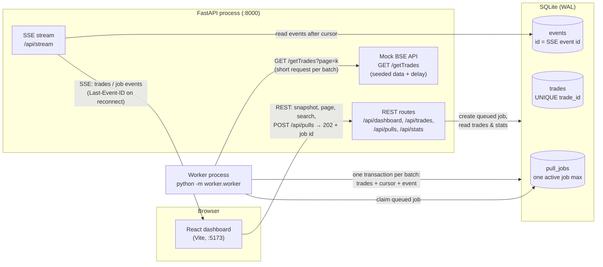

# Architecture

## The problem in one sentence

A full trade download takes **up to 15 minutes**, but the network **kills any HTTP connection after 30 seconds**,
and the dashboard must stay usable and update live the whole time.

## Overview



The same picture in more detail:

```
                ┌───────────────────────────────── Browser ─────────────────────────────────┐
                │  React dashboard (Vite, port 5173)                                        │
                │                                                                           │
                │   REST (fetch)                                  SSE (EventSource)          │
                │   • GET /api/dashboard  (snapshot + last_event_id)                         │
                │   • GET /api/trades     (page / search)        GET /api/stream?since=N     │
                │   • POST /api/pulls     (→ 202 + job id)        ◄── id:42 event:trades …   │
                └──────────────┬─────────────────────────────────────────────▲──────────────┘
                               │ Vite dev proxy /api → :8000                  │ auto-reconnect
                               ▼                                              │ Last-Event-ID: 42
┌──────────────────────────────────────── FastAPI process (port 8000) ───────┴──────────────┐
│  routes.py   REST endpoints. Each one is a few fast SQL queries.                          │
│  sse.py      tails the `events` table, streams rows > cursor, closes each stream at 25 s   │
│  mock_api.py GET /getTrades: deterministic data + artificial delay per page               │
└──────────────┬─────────────────────────────────────────────────────────────▲──────────────┘
               │ INSERT pull_jobs (queued)            read trades / events    │ GET /getTrades?page=k
               ▼                                                              │ (one short request per batch,
┌──────────────────────────── SQLite (database/trades.db, WAL mode) ─────────┐ │  ~0.4 s dev / ~18 s at 15 min)
│  pull_jobs  status, progress, next_page (resume cursor), error            │ │
│             partial UNIQUE index ⇒ at most one queued/running job          │ │
│  trades     UNIQUE(trade_id) ⇒ a trade can never be stored twice           │ │
│  events     append-only log; id = SSE event id                             │ │
└──────────────▲────────────────────────────────────────────────────────────┘ │
               │ claim job · per batch, ONE transaction:                       │
               │   insert trades + advance next_page + append event            │
┌──────────────┴─────────────────── Worker process (python -m worker.worker) ──┴─────────────┐
│  recover interrupted jobs → claim queued job → fetch page → validate → store → repeat      │
│  retries 5xx / network errors with exponential back-off, then marks the job failed        │
└───────────────────────────────────────────────────────────────────────────────────────────┘
```

## Request flow for one pull

1. **User clicks *Pull Trades*.** The browser sends `POST /api/pulls`.
2. **The API** opens a write transaction, checks for an active job, inserts a `queued` job and a `job` event,
   and replies **202 Accepted `{job_id, status: "queued"}`** within milliseconds. If a job is already active it
   replies **409** with that job. The partial unique index stops a race between two processes as well.
3. **The worker** (which checks the queue every second) claims the job atomically (`queued → running`).
4. For each page it makes **one short HTTP call** to `GET /getTrades?page=k&page_size=100`, validates the records, and then, in **one SQLite transaction**:
   - inserts the trades with `ON CONFLICT(trade_id) DO NOTHING` and counts which rows were really new,
   - advances the job's `next_page`, `pages_done`, and fetched/inserted/duplicate counters,
   - appends an `events` row: `{type: "trades", trades: [only new rows], stats, job}`.
5. **The API's SSE endpoint** sees the new event row and pushes it to every open dashboard.
6. **The dashboard** prepends the new rows, replaces the stat cards with the server-computed `stats`, and moves the progress bar.
7. After the last page the worker marks the job `succeeded` (or `failed` with a message) and emits a final `job` event.

## Key design decisions

### 1. REST for commands and queries, SSE for notifications

| | REST | SSE |
|---|---|---|
| Direction | Browser asks → server answers | Server pushes → browser |
| Lifetime | One short request | Long-lived stream (reconnects automatically) |
| Used for | Snapshot, paging, search, start pull, job status | "Batch stored", "job progress/finished" |

SSE is plain HTTP, works through the Vite proxy, needs no extra library (the browser's `EventSource`), and has
**reconnect-with-last-event-id built into the standard**. WebSockets would add two-way messaging the app doesn't need.

### 2. A separate worker process instead of doing the work in the request

Holding `POST /api/pulls` open for 15 minutes is impossible because the network cuts it at 30 s. A FastAPI
`BackgroundTask` or thread would also be fragile: it would die with the API process, be tied to one uvicorn
worker, and compete with request handling. A separate process:

- answers the user immediately, because the API only writes a `queued` row,
- never depends on one long-lived HTTP connection, because each batch is its own short request,
- can be restarted, scaled or deployed independently,
- **resumes** where it stopped, because `next_page` is committed with each batch.

The job table in SQLite serves as the queue. That avoids running Redis/RabbitMQ for a local assessment, and the
same design maps directly onto Celery/RQ later.

### 3. Exactly-once storage

- `trades.trade_id` is `UNIQUE`; inserts use `ON CONFLICT DO NOTHING`. Re-fetching a page, running a second
  pull, or two workers racing can never create duplicates.
- Trades, the resume cursor and the SSE event are written in **one transaction**. A crash can't leave trades
  stored without the cursor (or the cursor advanced without the trades).
- Money is stored as integer **paise**, so totals contain no floating-point drift.

### 4. Reliable live updates (no polling in the browser)

- **No gap between snapshot and stream.** `GET /api/dashboard` returns the data *and* `last_event_id` from the
  same read transaction, and the browser then opens `/api/stream?since=<that id>`.
- **Reconnects lose nothing.** Every SSE message carries `id: <events.id>`. When the connection drops,
  `EventSource` reconnects and sends `Last-Event-ID`, and the server replays everything after it.
- **The 30-second rule applies to SSE too.** The server closes each stream after `SSE_MAX_CONNECTION_SECONDS`
  (25 s) and sends `retry: 1000`, so the browser reconnects about 1 s later and resumes from its last id. The UI uses a
  short grace period so the *Live* indicator doesn't flicker.
- **Pruned history triggers `resync`.** If a client asks for events older than the retained window, the server
  sends `resync` and the client reloads its REST snapshot.
- **No duplicate rows in the UI.** Events contain only rows that were *actually inserted*. The table is ordered by
  the database `id`, and the client only prepends rows with `id` greater than the newest one it shows (and checks
  `trade_id` too), so replayed events are harmless. Stat cards take the server's numbers instead of adding up
  deltas, so they stay correct after a reconnect.
- If the user is on page 2+ or searching, rows are not inserted under them. A *"N new trades – Show latest"*
  banner appears instead.

### 5. Duplicate-pull prevention

Two layers:

1. The API checks for a `queued`/`running` job inside a `BEGIN IMMEDIATE` transaction and returns 409.
2. A **partial unique index** (`ON pull_jobs((status IN ('queued','running'))) WHERE status IN (…)`) makes a
   second active job impossible at the database level, even across processes.

### 6. Failure handling

| Failure | Behaviour |
|---|---|
| Upstream 5xx / 429 / timeout / connection error | Retry with exponential back-off (`WORKER_MAX_RETRIES`). Each retry is shown on the job as a warning |
| Retries exhausted, 4xx, malformed data | Job → `failed` with a readable `error`. Already-stored batches are kept. A new pull can be started |
| Worker crash / Ctrl+C | Job remains `running` and is re-queued on worker start-up (or after `WORKER_STALE_SECONDS` without a heartbeat), then resumes from `next_page` |
| Worker not running | Job waits in `queued`. The UI says it is waiting for the worker |
| API down while the dashboard is open | Header shows *Reconnecting…*. The stream resumes from the last event id when the API returns |

### 7. Mock API delay model

`MOCK_FULL_PULL_SECONDS` is the total time to download everything. Each request sleeps
`full × records_in_page ÷ total_records`, so the full pull lasts exactly the configured time regardless of batch
size. Defaults: 20 s in development (0.4 s per 100-trade page). The realistic setting is 900 s (18 s per page, below the
30 s limit). Data comes from `random.Random(MOCK_SEED)`, so it is identical on every run.

## What would change for production

- PostgreSQL instead of SQLite, and `LISTEN/NOTIFY` (or Redis pub/sub) instead of the 0.5 s server-side events-table check.
- A proper job queue (Celery/RQ/Arq) with several workers, using heartbeat-based recovery only.
- Authentication and authorisation on the API and the stream.
- Serve the built frontend behind the same reverse proxy as the API, with buffering disabled for `/api/stream`.
